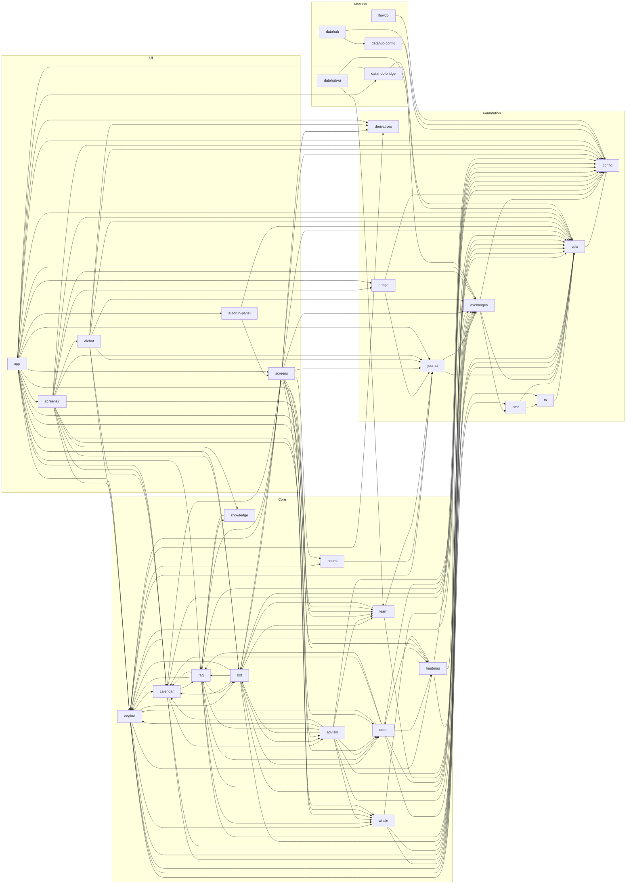

# Trade.2026 — Architecture (audit snapshot 2026-11-26)

Snapshot taken at main `604b3dd` ("auto: cap nhat lich kinh te 2026-11-26 13:13"), APP_VERSION 2.17.5.
All numbers below were counted from this working tree by a throwaway script (`/tmp/arch-count.js`, not committed) plus direct greps; nothing is estimated.

---

## 1. Overview

| Metric | Value | How counted |
|---|---|---|
| Browser runtime script files | **29** | `<script src>` tags in `index.html`, in load order |
| Station-only runtime module | **1** (`assets/js/liq-feed.js`, 173 lines) — loaded by `tools/collector-247.js` into the GitHub Actions VM, **not** by the browser | grep of index.html + collector-247.js |
| Total lines, 29 browser files | **11,491** | `wc -l` per file, summed |
| Top-level declarations (29 files) | **348** | regex over `function X` / `const X =` / `class X` / `window.X =` at column 0 (IIFE-internal functions of the datahub family not counted) |
| Cross-file reference edges (unique file pairs) | **125** | name declared in A, word-boundary referenced in B, names ≥4 chars |
| File-level dependency cycles | dense (thousands of paths) — see §6 | DFS on file-level graph |
| GitHub Actions workflows | **6** (station-247, station-bridge, station-sender, station-skill-5m, station-snapshot, update-calendar) | `ls .github/workflows/` |
| Serverless endpoints | **1** (`api/ai-proxy.js`, 71 lines) | file count |

**Entry chain (browser):** `index.html` → `config.js` (settings, weights, endpoints) → `utils.js` (formatters, DOM) → `ta.js` → `smc.js` → `exchanges.js` → `derivatives.js` → `journal.js` → `bridge.js` → `engine.js` → `neural.js` → `whale.js` → `calendar.js` → `bot.js` → `rag.js` → `order.js` → `learn.js` → `advisor.js` → `heatmap.js` → `knowledge.js` → `screens.js` → `autorun-panel.js` → `aichat.js` → `screens2.js` → `app.js` (boot, wires tabs) → then the Data-Hub family `datahub.config.js` → `datahub.js` → `flowdb.js` → `datahub-ui.js` → `datahub-bridge.js`. There is **no module system**: every file attaches globals to `window` and cross-file calls resolve by load order.

**Entry chain (station 24/7):** GitHub Actions `station-247.yml` (cron every 5 min) → `tools/station-run.js` → `tools/collector-247.js` (Node VM sandbox) → loads `assets/js/{config,utils,ta,smc,exchanges,journal,engine,liq-feed,...}.js` → analyzes watchlist → `tools/push-247.js` commits signals to the `data` branch (`data/browser-signals.json`) → browsers pull via `bridge.js`.

**Hubs (file-level dependents):** `utils.js` consumed by 20 files, `config.js` by 18, `exchanges.js` by 12, `engine.js` by 9. By raw name-reference volume the hottest targets are `app.js` (46 name-refs inbound), `engine.js` (38), `screens2.js` (32), `screens.js` (31). Biggest outward couplers: `utils.js` (81 name-refs out), `config.js` (38), `calendar.js` (29), `exchanges.js` (24).

---

## 2. Entity list

Types: `spa-js` = browser script; `station-js` = station-only module; `page` = HTML shell; `api` = serverless function; `wf` = GitHub Actions workflow; `tool` = Node/Python tool; `data` = JSON data file (main branch).

| Name | Type | Path | Potential dependents (who consumes it) |
|---|---|---|---|
| config | spa-js | assets/js/config.js | 18 files (engine, screens, rag, bot, order, utils, exchanges, screens2, bridge, whale, calendar, advisor, heatmap, aichat, app, datahub, flowdb, datahub.config) |
| utils | spa-js | assets/js/utils.js | 20 files (screens, bot, engine, order, advisor, heatmap, whale, calendar, learn, rag, exchanges, journal, ta, smc, derivatives, aichat, screens2, app, datahub-ui, datahub-bridge) |
| ta | spa-js | assets/js/ta.js | engine, smc |
| smc | spa-js | assets/js/smc.js | engine, exchanges |
| exchanges | spa-js | assets/js/exchanges.js | 12 files (screens, bot, journal, whale, rag, heatmap, screens2, app, engine, order, advisor, smc) |
| derivatives | spa-js | assets/js/derivatives.js | aichat, engine, app |
| journal | spa-js | assets/js/journal.js | learn, app, utils, bridge, engine, neural |
| bridge | spa-js | assets/js/bridge.js | screens2, app |
| engine | spa-js | assets/js/engine.js | 9 files (rag, advisor, order, heatmap, screens, aichat, bot, neural, app) |
| neural | spa-js | assets/js/neural.js | engine, journal |
| whale | spa-js | assets/js/whale.js | screens2, rag, advisor, engine |
| calendar | spa-js | assets/js/calendar.js | screens2, rag, advisor, engine, bot, order, aichat, app |
| bot | spa-js | assets/js/bot.js | app, rag, screens2, engine, order, learn, advisor, calendar, screens |
| rag | spa-js | assets/js/rag.js | app, bot, order, screens, advisor, engine, whale |
| order | spa-js | assets/js/order.js | utils, rag, bot, heatmap, screens, advisor, app, engine, calendar |
| learn | spa-js | assets/js/learn.js | bot, screens2, datahub-ui, app, advisor |
| advisor | spa-js | assets/js/advisor.js | screens, app, calendar, bot, rag, order, learn |
| heatmap | spa-js | assets/js/heatmap.js | app, engine, order, screens |
| knowledge | spa-js | assets/js/knowledge.js | rag, screens2 |
| screens | spa-js | assets/js/screens.js | app, bot, rag, order, advisor, autorun-panel |
| autorun-panel | spa-js | assets/js/autorun-panel.js | screens, app |
| aichat | spa-js | assets/js/aichat.js | screens2, derivatives, app |
| screens2 | spa-js | assets/js/screens2.js | app, calendar, aichat, journal, whale, bot, learn, bridge, knowledge |
| app | spa-js | assets/js/app.js | screens, screens2, autorun-panel, bridge, datahub-bridge (wires tabs) |
| datahub.config | spa-js | assets/js/datahub.config.js | datahub |
| datahub | spa-js | assets/js/datahub.js | datahub-ui, datahub-bridge, exchanges, engine, rag |
| flowdb | spa-js | assets/js/flowdb.js | datahub-ui, engine, rag |
| datahub-ui | spa-js | assets/js/datahub-ui.js | (self-contained tab UI; consumed via DOM) |
| datahub-bridge | spa-js | assets/js/datahub-bridge.js | exchanges, app |
| liq-feed | station-js | assets/js/liq-feed.js | tools/collector-247.js only |
| index | page | index.html | loads all 29 scripts; Vercel static hosting |
| ai-proxy | api | api/ai-proxy.js | aichat.js (via AI_PROXY_URL when configured) |
| station-247 | wf | .github/workflows/station-247.yml | runs tools/station-run.js |
| station-bridge | wf | .github/workflows/station-bridge.yml | runs tools/bridge-supabase.js |
| station-sender | wf | .github/workflows/station-sender.yml | runs tools/telegram-sender.js |
| station-skill-5m | wf | .github/workflows/station-skill-5m.yml | runs tools/skill-autorun-5m.js |
| station-snapshot | wf | .github/workflows/station-snapshot.yml | runs tools/snapshot-12h-supabase.js |
| update-calendar | wf | .github/workflows/update-calendar.yml | runs tools/update_calendar.py (schedule currently commented out; Linode fallback script pushes instead) |
| tools (20 files, 6,214 lines) | tool | tools/*.js, tools/*.py, tools/proxy/ | workflows, harness, collectors, backfills, NN training |
| data (5 files, ~1.73 MB on main) | data | data/*.json | browser bootstrap (calendar, flow history), station outputs mirrored on `data` branch |

---

## 3. Map

One edge per cross-file reference pair (125 edges). Arrow reads **consumer → provider** (`A --> B` = A calls/uses globals declared in B). Label = number of distinct names shared (shown when ≥6). Load order in `index.html` resolves everything at boot; there are no ES imports.

External services called at runtime (not files): Binance REST/vision + WebSocket, OKX, MEXC, Hyperliquid, Bybit (via DataHub), CoinGecko, Alternative.me (Fear&Greed), r.jina.ai reader proxy, public CORS proxies, TradingView embeds, Tesseract CDN, Supabase (station warehouse), GitHub Contents API (data branch), Telegram (station sender), Novita→UTIM→APINEX→River AI chain (via ai-proxy or direct).

## 4. Per-entity evidence

Method: declarations counted at top level of each file (const/let/function/class); "direct dependents" = other app files referencing those declaration names with word boundaries (names >= 4 chars to avoid false positives); "depends on" = the reverse direction. Line numbers refer to main @ `604b3dd`.

#### `config.js` — 133 lines, 25 top-level declarations

- **Direct dependents (consume its declarations):** `engine.js` (6 names), `screens.js` (6 names), `rag.js` (4 names), `bot.js` (3 names), `order.js` (3 names), `utils.js` (2 names), `exchanges.js` (2 names), `screens2.js` (2 names)
- **Depends on (consumes):** nothing in app
- **Declarations:** `APP_VERSION`:6, `APP_NAME`:7, `SIRO_VERSION`:8, `WATCHLIST_CORE`:11, `WATCHLIST_PHU`:12, `SESSIONS_VN`:15, `KILLZONES_UTC`:22, `RISK_DEFAULTS`:28, `TIMEFRAMES`:41, `ENDPOINTS`:48, `CHECKLIST_WEIGHTS`:66, `KILLZONE_BONUS`:74, `RAG_WEIGHTS`:79, `RAG_HEATMAP_ADJ`:80 …

#### `utils.js` — 158 lines, 27 top-level declarations

- **Direct dependents (consume its declarations):** `screens.js` (11 names), `bot.js` (10 names), `engine.js` (7 names), `order.js` (7 names), `advisor.js` (7 names), `heatmap.js` (6 names), `whale.js` (5 names), `calendar.js` (5 names)
- **Depends on (consumes):** `config.js` (2 names), `journal.js` (1 names), `order.js` (1 names)
- **Declarations:** `fmtGia`:7, `giaVaoHienThi`:16, `fmtPct`:20, `fmtUsd`:24, `fmtSo`:33, `gioVN`:36, `fmtThoiGian`:44, `fmtGio`:48, `trongKhungGio`:51, `phienHienTai`:53, `dangKillzone`:57, `$`:65, `$$`:66, `el`:67 …

#### `ta.js` — 218 lines, 16 top-level declarations

- **Direct dependents (consume its declarations):** `engine.js` (5 names), `smc.js` (3 names)
- **Depends on (consumes):** `utils.js` (1 names)
- **Declarations:** `_num`:8, `emaSeries`:11, `emaLast`:27, `smaSeries`:29, `rsiSeries`:43, `atrSeries`:66, `atrLast`:89, `isPivotHigh`:92, `isPivotLow`:97, `findPivots`:102, `pivotDaXacNhan`:117, `highestPrior`:124, `lowestPrior`:129, `volumeProfile`:136 …

#### `smc.js` — 480 lines, 16 top-level declarations

- **Direct dependents (consume its declarations):** `engine.js` (12 names), `exchanges.js` (1 names)
- **Depends on (consumes):** `ta.js` (3 names), `utils.js` (1 names)
- **Declarations:** `normalizeKlines`:10, `phanTichCauTruc`:18, `timSweepGanNhat`:48, `timChoCh`:84, `kiemTraIDM`:113, `timFVG`:135, `timOrderBlocks`:159, `timEqualLevels`:195, `dealingRange`:214, `danhGiaTrangThai`:238, `chonPOI`:257, `demChamOB`:302, `danhGiaChatLuongOB`:312, `thongSoNen`:373 …

#### `exchanges.js` — 340 lines, 11 top-level declarations

- **Direct dependents (consume its declarations):** `screens.js` (4 names), `bot.js` (3 names), `journal.js` (2 names), `whale.js` (2 names), `rag.js` (2 names), `heatmap.js` (2 names), `screens2.js` (2 names), `app.js` (2 names)
- **Depends on (consumes):** `config.js` (2 names), `utils.js` (2 names), `smc.js` (1 names)
- **Declarations:** `OKX_BAR`:9, `fetchKlines`:11, `fetchKlinesTu`:43, `CACHE_ALL_COINS`:75, `layTatCaCoinBinance`:76, `napDropdownCoinBinance`:112, `fetchDepth`:136, `fetchFearGreed`:146, `slotGiaTheoSan`:169, `PriceHub`:178, `PRICE_HUB`:340

#### `derivatives.js` — 293 lines, 18 top-level declarations

- **Direct dependents (consume its declarations):** `aichat.js` (4 names), `engine.js` (1 names), `app.js` (1 names)
- **Depends on (consumes):** `utils.js` (1 names)
- **Declarations:** `annualizedFunding`:17, `fundingRegime`:28, `oiFundingSignal`:50, `danhGiaLiq`:68, `fmtUsdSafe`:81, `diemStablecoin`:95, `STABLECOIN_STATE`:105, `taiStablecoinPulse`:106, `hvPercentile`:148, `OI_LUU`:171, `_oiTimer`:172, `ghiNhanOI`:173, `oiThayDoi`:187, `DERIV_CACHE`:200 …

#### `journal.js` — 751 lines, 13 top-level declarations

- **Direct dependents (consume its declarations):** `learn.js` (2 names), `app.js` (2 names), `utils.js` (1 names), `bridge.js` (1 names), `engine.js` (1 names), `neural.js` (1 names)
- **Depends on (consumes):** `utils.js` (2 names), `exchanges.js` (2 names), `screens2.js` (1 names)
- **Declarations:** `JOURNAL`:17, `tinhNetR`:268, `chamDiemLenh`:274, `giaKetThuc`:315, `chenhLechGia`:324, `fmtChenhLech`:332, `thongKeJournal`:340, `_thongKeCore`:350, `rutBaiHocKaizen`:394, `TRANG_THAI_JOURNAL`:553, `fmtNgayGio`:561, `bangPhanBo`:565, `renderSoTinHieu`:580

#### `bridge.js` — 126 lines, 1 top-level declarations

- **Direct dependents (consume its declarations):** `screens2.js` (1 names), `app.js` (1 names)
- **Depends on (consumes):** `config.js` (1 names), `journal.js` (1 names), `app.js` (1 names)
- **Declarations:** `BRIDGE`:13

#### `engine.js` — 464 lines, 4 top-level declarations

- **Direct dependents (consume its declarations):** `rag.js` (3 names), `advisor.js` (3 names), `order.js` (2 names), `heatmap.js` (2 names), `screens.js` (2 names), `aichat.js` (2 names), `whale.js` (1 names), `bot.js` (1 names)
- **Depends on (consumes):** `smc.js` (12 names), `utils.js` (7 names), `config.js` (6 names), `ta.js` (5 names), `calendar.js` (2 names), `exchanges.js` (1 names), `derivatives.js` (1 names), `journal.js` (1 names)
- **Declarations:** `SIGNAL_CACHE`:14, `PHASE_LABELS`:16, `phanTichCoin`:26, `verdictLabel`:461

#### `neural.js` — 469 lines, 22 top-level declarations

- **Direct dependents (consume its declarations):** `engine.js` (1 names)
- **Depends on (consumes):** `journal.js` (1 names)
- **Declarations:** `mulberry32`:32, `clamp01`:41, `NN_NEN_LOAI`:49, `NN_TEN_DAC_TRUNG`:50, `doManhBias`:52, `dacTrungTho`:58, `trichDacTrung`:77, `NN_SO_DAC_TRUNG`:102, `NN_KIEN_TRUC`:103, `NN_PHEN_BAN_DAC_TRUNG`:104, `NN_STRATEGY_VERSION`:105, `dacTrungTuEngine`:110, `taoSnapshotDacTrung`:130, `kiemTraSnapshot`:151 …

#### `whale.js` — 143 lines, 3 top-level declarations

- **Direct dependents (consume its declarations):** `screens2.js` (2 names), `rag.js` (1 names), `advisor.js` (1 names), `app.js` (1 names)
- **Depends on (consumes):** `utils.js` (5 names), `exchanges.js` (2 names), `config.js` (1 names), `engine.js` (1 names)
- **Declarations:** `okxJson`:11, `tinhWhaleScore`:17, `fetchLenhLon`:134

#### `calendar.js` — 382 lines, 29 top-level declarations

- **Direct dependents (consume its declarations):** `screens2.js` (11 names), `rag.js` (5 names), `advisor.js` (5 names), `engine.js` (2 names), `bot.js` (2 names), `order.js` (2 names), `aichat.js` (1 names), `app.js` (1 names)
- **Depends on (consumes):** `utils.js` (5 names), `config.js` (1 names)
- **Declarations:** `CAL`:17, `CAL_IMPORT_KEY`:18, `tzOffsetTuPayload`:21, `parseGio12h`:25, `demSao`:32, `normalizeAgentPayload`:34, `taiLichKinhTe`:62, `napFileJson`:122, `CAL_JINA_KEY`:143, `CAL_JINA_TTL`:144, `uocLuongImp`:146, `fetchTEQuaJina`:155, `parseJinaTE`:170, `fetchTEQuaProxy`:208 …

#### `bot.js` — 503 lines, 4 top-level declarations

- **Direct dependents (consume its declarations):** `app.js` (3 names), `rag.js` (2 names), `order.js` (2 names), `screens2.js` (2 names), `engine.js` (1 names), `learn.js` (1 names), `advisor.js` (1 names), `screens.js` (1 names)
- **Depends on (consumes):** `utils.js` (10 names), `config.js` (3 names), `exchanges.js` (3 names), `calendar.js` (2 names), `engine.js` (1 names), `learn.js` (1 names)
- **Declarations:** `BOT_KEY`:12, `PaperBot`:14, `WHALE_CACHE`:502, `PAPER_BOT`:503

#### `rag.js` — 341 lines, 6 top-level declarations

- **Direct dependents (consume its declarations):** `app.js` (2 names), `order.js` (1 names), `advisor.js` (1 names), `screens.js` (1 names)
- **Depends on (consumes):** `calendar.js` (5 names), `config.js` (4 names), `utils.js` (3 names), `engine.js` (3 names), `exchanges.js` (2 names), `bot.js` (2 names), `whale.js` (1 names), `order.js` (1 names)
- **Declarations:** `RAG`:21, `truyXuatKienThuc`:24, `ragPipeline`:45, `ragGoiYLabel`:229, `renderRagAuto`:234, `veRagRun`:274

#### `order.js` — 431 lines, 10 top-level declarations

- **Direct dependents (consume its declarations):** `utils.js` (1 names), `rag.js` (1 names), `advisor.js` (1 names), `heatmap.js` (1 names), `screens.js` (1 names), `app.js` (1 names)
- **Depends on (consumes):** `utils.js` (7 names), `config.js` (3 names), `engine.js` (2 names), `calendar.js` (2 names), `bot.js` (2 names), `exchanges.js` (1 names), `rag.js` (1 names)
- **Declarations:** `TICKET`:15, `giaSan`:17, `moDatLenh`:22, `dongDatLenh`:63, `tinhTicket`:66, `veTicket`:99, `capNhatSLTPMacDinh`:248, `kiemTraAnToanLenh`:263, `xacNhanDatLenh`:364, `capNhatTicketGia`:412

#### `learn.js` — 514 lines, 23 top-level declarations

- **Direct dependents (consume its declarations):** `bot.js` (1 names), `advisor.js` (1 names), `app.js` (1 names), `datahub-ui.js` (1 names)
- **Depends on (consumes):** `utils.js` (4 names), `journal.js` (2 names), `bot.js` (1 names), `screens2.js` (1 names)
- **Declarations:** `LEARN_KEY`:12, `LEARN`:13, `luuLearn`:15, `TRAM_JOURNAL_URL`:23, `TIN_HIEU_TRAM`:24, `_tramBaiHoc`:25, `_tramCapNhat`:26, `_tramTimer`:27, `SIG`:28, `tinHieuSangMuc`:31, `layLichSuTinHieu`:54, `napTinHieuTram`:75, `hocTuTinHieu`:94, `_slice`:186 …

#### `advisor.js` — 411 lines, 9 top-level declarations

- **Direct dependents (consume its declarations):** `screens.js` (1 names)
- **Depends on (consumes):** `utils.js` (7 names), `calendar.js` (5 names), `engine.js` (3 names), `config.js` (1 names), `exchanges.js` (1 names), `whale.js` (1 names), `bot.js` (1 names), `rag.js` (1 names)
- **Declarations:** `ADVISOR`:11, `parseTradeInput`:14, `napScript`:57, `ocrAnh`:64, `phanTichLenhNguoiDung`:76, `veAdvisorPanel`:243, `xuLyAnh`:280, `chayAdvisor`:307, `veAdvisorKetQua`:329

#### `heatmap.js` — 351 lines, 14 top-level declarations

- **Direct dependents (consume its declarations):** `app.js` (2 names), `engine.js` (1 names)
- **Depends on (consumes):** `utils.js` (6 names), `exchanges.js` (2 names), `engine.js` (2 names), `config.js` (1 names), `order.js` (1 names)
- **Declarations:** `HM_TIMEFRAMES`:18, `HM_LEV_MODEL`:26, `HM_BINS`:32, `HM_VOL_FRACTION`:33, `HEATMAP_CACHE`:35, `HM_STATE`:36, `tinhHeatmap`:39, `phanTichHeatmap`:86, `heatmapChoEngine`:123, `viridis`:132, `veHeatmapCanvas`:144, `renderHeatmap`:240, `capNhatHeatmapUI`:275, `veHeatmapAnalysis`:289

#### `knowledge.js` — 179 lines, 1 top-level declarations

- **Direct dependents (consume its declarations):** `rag.js` (1 names), `screens2.js` (1 names)
- **Depends on (consumes):** nothing in app
- **Declarations:** `KIEN_THUC`:8

#### `screens.js` — 955 lines, 29 top-level declarations

- **Direct dependents (consume its declarations):** `app.js` (14 names)
- **Depends on (consumes):** `utils.js` (11 names), `config.js` (6 names), `exchanges.js` (4 names), `app.js` (3 names), `engine.js` (2 names), `bot.js` (1 names), `rag.js` (1 names), `order.js` (1 names)
- **Declarations:** `renderTongQuan`:7, `capNhatPhienBar`:79, `capNhatFng`:92, `capNhatGiaTick`:101, `capNhatSigChip`:126, `danhGiaDongThuan`:140, `veGoiYHero`:162, `capNhatConnCard`:211, `SK_NGUON_GIA`:224, `SK_TICK_VANG`:232, `SK_BOQUA_DH`:233, `skTuoiTickMoiNhat`:235, `skFmtTuoi`:244, `veSucKhoeNguon`:250 …

#### `autorun-panel.js` — 187 lines, 19 top-level declarations

- **Direct dependents (consume its declarations):** `screens.js` (1 names)
- **Depends on (consumes):** `app.js` (1 names)
- **Declarations:** `AR_JOURNAL_URL`:16, `AR_GH_RUNS_URL`:17, `AR_GH_ACTIONS_URL`:18, `AR_GH_FOLDER_URL`:19, `AR_CACHE_MS`:20, `AR_GH_CACHE_MS`:21, `arTuoiPhut`:24, `arSlTpOk`:30, `arReviewTinHieu`:37, `arFmtTuoi`:53, `arFmtGio`:60, `arBadgeClass`:68, `vePanelAutoRun`:74, `_arCacheJournal`:84 …

#### `aichat.js` — 272 lines, 10 top-level declarations

- **Direct dependents (consume its declarations):** `screens2.js` (7 names)
- **Depends on (consumes):** `derivatives.js` (4 names), `engine.js` (2 names), `config.js` (1 names), `utils.js` (1 names), `calendar.js` (1 names)
- **Declarations:** `AI_PROVIDERS`:17, `AI_KEYS`:91, `AI_CFG`:99, `systemPromptRAG`:107, `fmtTime`:119, `xayDungNgucanhRAG`:123, `hoiAI`:218, `kiemTraKetNoiAI`:266, `AI_CHAT`:271, `resetLichSuAI`:272

#### `screens2.js` — 856 lines, 23 top-level declarations

- **Direct dependents (consume its declarations):** `app.js` (11 names), `journal.js` (1 names), `learn.js` (1 names)
- **Depends on (consumes):** `calendar.js` (11 names), `aichat.js` (7 names), `utils.js` (4 names), `config.js` (2 names), `exchanges.js` (2 names), `whale.js` (2 names), `bot.js` (2 names), `bridge.js` (1 names)
- **Declarations:** `WHALE_COIN`:7, `renderCaMap`:8, `capNhatWhale`:31, `veWhale`:46, `veLenhLon`:69, `renderBot`:89, `theStat`:165, `veBotPositions`:168, `veBotLogs`:218, `veBotHistory`:227, `veEquity`:246, `CAL_TAB`:269, `CAL_MIN_IMP`:270, `renderLich`:271 …

#### `app.js` — 208 lines, 13 top-level declarations

- **Direct dependents (consume its declarations):** `screens.js` (3 names), `datahub-bridge.js` (2 names), `bridge.js` (1 names), `autorun-panel.js` (1 names)
- **Depends on (consumes):** `screens.js` (14 names), `screens2.js` (11 names), `bot.js` (3 names), `utils.js` (2 names), `exchanges.js` (2 names), `journal.js` (2 names), `rag.js` (2 names), `heatmap.js` (2 names)
- **Declarations:** `SCREENS`:6, `SCREEN_HIENTAI`:21, `parseHash`:24, `dieuHuong`:35, `DANG_QUET`:45, `quetCoin`:46, `quetTatCa`:60, `JOURNAL_TUCHAM_KEY`:80, `coTheTuChamJournal`:81, `tuDongChamDiem`:90, `veHeaderStatus`:100, `veDongHo`:114, `boot`:120

#### `datahub.config.js` — 73 lines, 2 top-level declarations

- **Direct dependents (consume its declarations):** `datahub.js` (1 names)
- **Depends on (consumes):** `config.js` (1 names)
- **Declarations:** `DH_COINS`:8, `DH_CONFIG`:16

#### `datahub.js` — 709 lines, 0 top-level declarations

- **Direct dependents (consume its declarations):** none
- **Depends on (consumes):** `config.js` (1 names), `datahub.config.js` (1 names)
- **Declarations:** 

#### `flowdb.js` — 577 lines, 0 top-level declarations

- **Direct dependents (consume its declarations):** none
- **Depends on (consumes):** `config.js` (1 names)
- **Declarations:** 

#### `datahub-ui.js` — 785 lines, 0 top-level declarations

- **Direct dependents (consume its declarations):** none
- **Depends on (consumes):** `utils.js` (1 names), `learn.js` (1 names)
- **Declarations:** 

#### `datahub-bridge.js` — 153 lines, 0 top-level declarations

- **Direct dependents (consume its declarations):** none
- **Depends on (consumes):** `exchanges.js` (2 names), `app.js` (2 names), `utils.js` (1 names)
- **Declarations:** 

---

## 5. Impact analysis

There is no bundler, type checker or import graph the runtime would enforce: a broken rename surfaces only as a runtime `TypeError`/`undefined` in the browser console. Impact therefore equals "who spells this global name".

**Direct dependents (from §4 counts):**

| Change | Direct blast radius | Indirect chain |
|---|---|---|
| Rename/move anything in `utils.js` | up to 20 files | every screen render path; `app.js` boot |
| Rename/move anything in `config.js` | up to 18 files | weights, sessions, endpoints — engine, rag, bot, order, station collector all read it |
| `engine.js` verdict/plan logic | 9 direct consumers, 38 inbound name-refs | verdict ≥ 70 gates journal writes → learn stats → advisor → screens badges → station signals within one 3-frame cycle |
| `journal.js` record schema | learn, neural, bridge, bot, screens, app | station `push-247.js` and Supabase snapshots copy the same shape; a renamed field silently produces empty columns in history |
| `exchanges.js` API shapes | 12 consumers | klines/ticker field renames hit every screen and the engine at once |
| `data` branch `browser-signals.json` shape | written by `tools/push-247.js`, read by `bridge.js` | no schema/version field: a newer station and an older deployed browser disagree silently (empty badges, no error) |
| `index.html` script order | all 29 files | moving a `<script>` tag that defines a global below its first runtime consumer = `ReferenceError` at boot; `config.js`+`utils.js` must stay first, `app.js` must stay after `screens2.js` |

**Worked chains (each hop verified in §4):**

- `config.RAG_WEIGHTS` → `rag.js` scoring → `engine.js` verdict ≥ 70 → `journal.js` record → `learn.js` stats → `advisor.js` advice → `screens.js`/`screens2.js` badges. One weight edit re-scores every historical re-run and every live coin.
- `exchanges.fetchKlines` shape → `ta.js` indicators → `smc.js` patterns → `engine.js` verdicts → `bot.js` orders → `order.js` sizing.
- `config.KILLZONES_UTC`/`SESSIONS_VN` → `utils.trongKhungGio`/`phienHienTai` → engine killzone bonus → `rag.js` heat-map adjustment → screen countdowns.
- Station side: `config.js` is loaded into the Node VM by `tools/collector-247.js` — editing config for browser convenience also changes station behaviour (same file, two runtimes).

**Cache-bust drift (verified 2026-11-26):** `index.html` pins 8 distinct `?v=` strings across the 29 files (`2.1.0` … `2.17.5`); e.g. `learn.js` ships at `?v=2.1.0` although it was added on 21/11. Bumping `APP_VERSION` does not bust script caches, so a returning browser can mix file generations (new `engine.js` + old `rag.js`) with no error at all.

---

## 6. Evidence and coverage

**Coverage:** 29/29 browser runtime scripts analysed (100% of browser JS), plus station-only `liq-feed.js`; 6/6 workflows read; station tools read individually (`collector-247.js`, `push-247.js`, `station-run.js`, `harness_v2.js`, `backfill-flow-12h.py`, `bridge-browser.js`, `bridge-supabase.js`, `calendar-linode-fallback.sh`, `flow-collector.js`, `train-nn.js`); `api/ai-proxy.js` read in full. Tests executed for real during this audit: see the companion audit report, Part D.

**Method limits (what the counts do not claim):**

- Name matching uses word boundaries on globals ≥ 4 chars; shorter globals would be invisible. A name is attributed to a file only when declared exactly once repo-wide, which suppresses most false edges but can hide shadowed names.
- IIFE-internal functions of the datahub family are not enumerated (hence 0 declarations for `datahub.js`/`datahub-ui.js`/`datahub-bridge.js`) — their internal coupling is undercounted.
- Dynamic access (`window[varName]`, bracket notation) is not traced.
- 125 edges = unique file pairs, not call sites; a pair referenced 30 times counts once.

**Snapshot:** main `604b3dd` ("auto: cap nhat lich kinh te 2026-11-26 13:13"), working tree clean at count time, APP_VERSION 2.17.5.

**Static-analysis gaps found:**

- **Circular references:** the file-level graph is densely cyclic (`utils ↔ order ↔ journal ↔ app`, `screens ↔ screens2 ↔ app`, …) — thousands of cycles. Harmless at runtime only because nothing executes until `app.js` `boot()` at the end of the load order; it makes "dependency layers" meaningless and refactors all-or-nothing.
- **Stale edges:** not statically detectable in this architecture — resolution is runtime-global, so a renamed-but-still-referenced name surfaces only as a console `TypeError` on the screen that happens to call it.
- **Duplicates:** flow-window computation exists twice (`flowdb.js:409-412` and `engine.js:256`); `escapeHtml` (`utils.js:81`) is dead — screens escape inline instead; helper duplication catalogue in §4/Q-04 of the audit report (`el` vs `e`, `fetchJson` vs `getJson`, `ghiNhan` vs `ghiNhanGiay`, 4+ time formatters).
- **Unused:** `AI_PROXY_URL` declared in `config.js`, referenced nowhere (audit D-03); `escapeHtml` (above).

---

## 7. How to read

- "What breaks if I edit file X?" → §4 entry for X, line **Direct dependents**; then §5 for the indirect chain.
- "Trace a feature end-to-end" → §8 runtime flows first, then follow the arrows in the §3 map.
- "Judge the risk of a change" → §5 table + §6 gaps; all line numbers refer to main `604b3dd` — re-grep before citing after any merge.
- "Is a number here trustworthy?" → every count names its method (§1 table, §4 header); the counting script itself was throwaway and is not committed, so re-run counts with the same regexes if the tree moves.

---

## 8. Runtime data flow, architecture decisions, risks

*(Hand-written for this audit; the tab "Architecture" can only show static evidence.)*

### 8.1 Runtime flows

1. **Browser signal cycle** (user opens app / switches coin / 3-frame refresh): `app.js` boot wires tabs → `screens2.js` renders → `engine.js` `phanTichCoin` runs the 3-frame analysis (`smc.js` patterns + `ta.js` indicators + `derivatives.js` funding/OI) → `rag.js` scores → verdict ≥ 70 → `journal.js` records the signal → `bridge.js` publishes to the `data` branch (GitHub Contents API with the PAT) → `bot.js` tracks the position → `order.js` sizes the ticket. Everything dies when the tab closes (P-03).
2. **Station 24/7 cycle** (independent of any browser): GitHub Actions cron every 5 min (`station-247.yml`) → `tools/station-run.js` → `tools/collector-247.js` loads `config/utils/ta/smc/exchanges/journal/engine/liq-feed` into a Node VM → analyses the watchlist → `tools/push-247.js` commits `data/browser-signals.json` to the `data` branch → browsers poll it via `bridge.js` → `screens2.js` shows station badges. A second cron family (`update-calendar.yml` + Linode fallback script) pushes the economic calendar to **main** up to 4×/day.
3. **DataHub tab:** `datahub.js` opens exchange WebSockets (Binance primary, Bybit/Hyperliquid fallback) → `flowdb.js` accumulates per-minute flow buckets → `datahub-ui.js` renders → `datahub-bridge.js` mirrors spot/perp slots back into the engine's view.
4. **Warehouse/history:** `tools/bridge-supabase.js` and the snapshot workflow copy journal + flow into Supabase; the `data` branch stays the transport truth, Supabase the queryable archive.

### 8.2 Architecture decisions (as built, with their price)

| Decision | Why it was taken | Price paid |
|---|---|---|
| Static no-build SPA (no imports, no bundler) | zero toolchain, deploy = file copy, runs from GitHub Pages | no module/type safety; load-order fragility; manual `?v=` cache busting already drifted (§5) |
| `data` branch as message bus browser↔station | auditable JSON, free, no server | 5-min granularity, commit churn, no schema versioning, PAT needed client-side |
| Station on GitHub Actions cron | stateless, no daemon to babyspawn | 5-min cadence floor + cold-start; detection latency is structural, not a bug |
| `learn.js` propose-only (`LEARN_AUTO_APPLY=false`) | no feedback-loop drift in verdict weights | adoption is manual; stats can go stale |
| Supabase as warehouse, not source of truth | journal on `data` branch stays canonical | two copies can diverge; snapshot lag |

### 8.3 Top risks (cross-reference audit report)

1. **Secrets in the browser:** PAT sent as `Authorization: Bearer` from `bridge.js:84`, AI keys in `localStorage` (`aichat.js:92`) — anyone with repo read or a poisoned script can spend the account. Highest severity, decision pending (user decision #1).
2. **No CSP/SRI** (S-03/S-04): one tampered CDN script = full compromise; no `vercel.json` headers either (D-07).
3. **No CI runs tests; harness machine-bound** (`harness_v2.js:1450` hard-codes `/home/hatch/...`): regressions reach production undetected outside the user's laptop (new finding N-1).
4. **Journal stop-write at cap** (`journal.js` `_max` 300): silent data loss during active sessions (P-08).
5. **Main-branch data churn:** calendar fallback commits to main 4×/day (N-4) — merge friction with code work, repo bloat (D-09).
6. **27 empty `catch {}` blocks** (Q-05): failures vanish exactly where an early-warning system can least afford it.

### 8.4 Exception branch — nháhn ngoai lé, tier (B) (added 26/11/2026)

Standalone branch under `exception/`, calibrated on the real 25/11→26/11/2026 night (guide: `skills/trade-2026-project/references/exception-branch-guide-2026-11-26.md`). Tier (B) heads-up + đđng nhank only — no auto-action; it imports nothing from the trading path (`watcher.js:12-19` requires only its own siblings) and **writes only under `exception/logs/`**. Ships default-off (`EXCEPTION_ENABLED:false` in `exception/config.json:3`; env override for a systemd toggle, checked before any fetch/write). Reads `data/economic_calendar_data.json` read-only for ★★★ news ±60 ph.

Flow: ~15 s poll (OKX 1m+15m, Binance fallback) → on each closed 15m bar sync gate (≥3 coins \|chg\|≥1.3%, vol spike ×3 REQUIRED, cooldown 45 min per direction — opposite direction always allowed) or on each closed 1m bar đđng nhank (≥0.6%) → heads-up message (locked tokens: banner, `TĂNG`/`GIẢM`, `đđng nhank`, no-news line that never assigns a cause) → 3 channels (Telegram, WhatsApp with outbox fallback, Tradewatch = INSERT into Supabase `signals` table, default-off, optional POST /api/monitor/run with MONITOR_SECRET — tradewatch has no receiving webhook) → `exception/logs/heads-up.jsonl`; forward returns logged at +15/+60/+240 ph, no advice.

Replay on 8 weeks real candles, tightened gate (chg 1.3% + mandatory vol spike ×3; regenerated 26/11/2026, Binance source, 5376 bars): 15 fires ≈ 1.9/week (inside the 1–3/week target; the earlier chg-1.0 gate gave 3.8/week), 6 UP / 9 DOWN, exactly 1 news-coincident fire — the 21:30 25/11 calibration case (★★★ ×5), plus the 21:45 whipsaw mirror UP +1,97. Latency measured 26/11: bar close → heads-up written/queued ≈ 2.8–4.7 ms. Tests: `node tools/test-exception.js` → 75 pass / 0 fail (E1 gate pins on the fixture night, E2 calendar, E3 locked tokens, E4 on/off, E5 pure core, E6 channels incl. Supabase signals insert, E7 latency).
